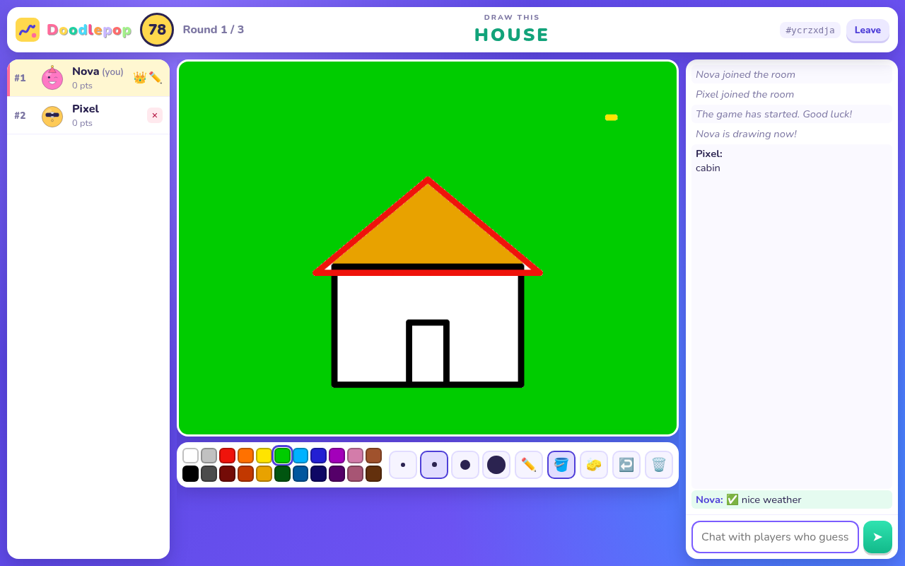
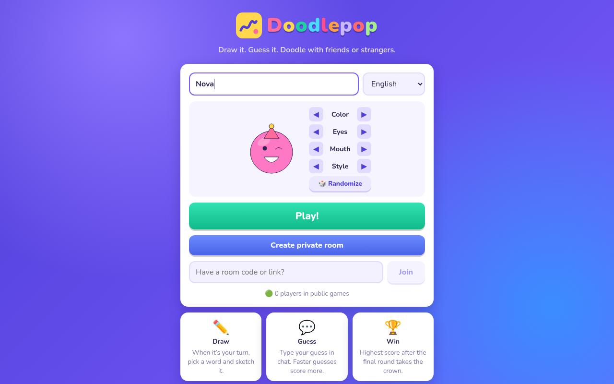
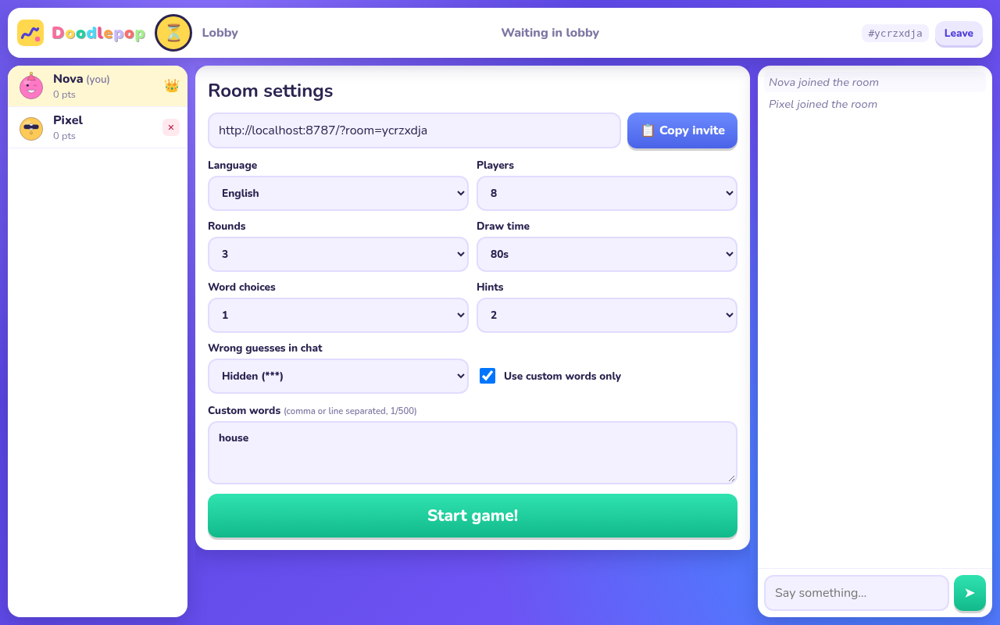
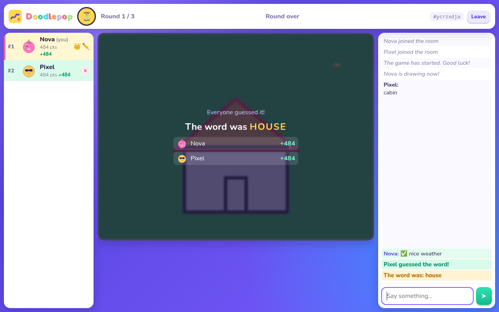
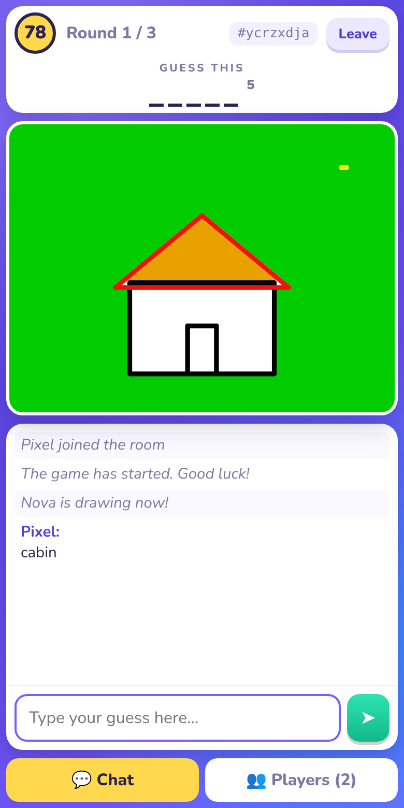

# Doodlepop ✏️

**Doodlepop is a free, multiplayer drawing-and-guessing game in the style of skribbl.io.** One player draws a secret
word, everyone else races to guess it in chat — the faster you guess, the more points you score. Play with friends in
a private room, or jump into public matchmaking and get dropped into a game with strangers. No accounts: pick a
nickname and an avatar and play.

It runs entirely on **Cloudflare Workers + Durable Objects (WebSocket Hibernation) + Workers Assets**, with a small
Preact/Vite frontend.

> **Not affiliated with skribbl.io.** Doodlepop is an independent, original project inspired by the genre's gameplay.
> The name, logo, avatars, UI and word lists are original; nothing is copied from skribbl.io.

<!-- LIVE_URL -->



<table>
  <tr>
    <td></td>
    <td></td>
  </tr>
  <tr>
    <td></td>
    <td align="center"></td>
  </tr>
</table>

## Features

- **Quick play** – public matchmaking per language; players are packed into the fullest open room, new rooms are
  created on demand, public games auto-start once two or more players are present
- **Private rooms** – shareable invite link/code, host-controlled settings, kick, host migration
- **Full round flow** – word choice → drawing → guessing → speed-based scoring → reveal → next drawer → leaderboard → play again
- **Drawing tools** – 22 colours, 4 brush sizes, brush / flood fill / eraser, undo, clear; strokes sync live and late
  joiners receive the current canvas
- **Settings** – 2–12 players, 1–10 rounds, 15–240 s draw time, 1–5 word choices, 0–5 hints, language, custom words,
  custom-words-only mode, hidden (`***`) or visible wrong guesses
- **Chat & guessing** – case/accent/punctuation-insensitive matching, "is close!" feedback for near misses, a private
  channel for the drawer and players who already guessed, drawer can't leak the word, rate limiting
- **Avatars** – generated SVG avatars (colour × eyes × mouth × accessory = 6,912 combinations), no image assets
- **Resilient** – refresh or drop your connection and you keep your seat and score (45 s grace in game, 10 s in lobby);
  a leaving drawer ends the turn instead of stalling the game
- **Languages** – English (870+ words) plus starter packs for German, Spanish and French; easy to add more
- **Responsive** – three-column desktop layout, stacked mobile layout with chat/players tabs

## Architecture

```
Browser ── GET /               ─► Workers Assets (web/dist, SPA fallback)
        ── POST /api/quickplay ─► Worker ─► Matchmaker DO "mm:<lang>" ─► fullest open public room,
                                                  ▲                       or creates one
        ── POST /api/rooms     ─► Worker ─► GameRoom.init (private)       │
        ── WS   /ws/<code>     ─► Worker ─► GameRoom DO "<code>" ─ report(players, phase) ┘
```

| Piece | Where | Notes |
|---|---|---|
| Worker entry | `worker/src/index.ts` | REST (`/api/*`), WebSocket routing (`/ws/:code`, same-origin only), asset fallback |
| `GameRoom` Durable Object | `worker/src/room.ts` | One per room. Whole game state machine. Hibernating WebSockets; **one alarm** drives every timer (word choice, draw clock, hints, reveal, lobby auto-start, reconnect grace, empty-room cleanup) and is re-armed after each state change. State and drawing ops are persisted, so a room survives eviction |
| `Matchmaker` Durable Object | `worker/src/matchmaker.ts` | One per language. Registry of public rooms (rooms report occupancy), fullest-first selection, 15 s seat reservations, stale-entry pruning |
| Game logic | `worker/src/logic.ts` | Pure, unit-tested: scoring, hints, guess matching, sanitising, settings validation |
| Word packs | `worker/src/words/` | Bundled lists; optional KV override at runtime |
| Wire protocol | `shared/protocol.ts` | Typed messages, limits and defaults shared by Worker and web |
| Frontend | `web/` | Preact + Vite, built to `web/dist` and served by Workers Assets |

The server never trusts the client: names, avatars, colours, coordinates, settings and message sizes/rates are all
validated or clamped, only the drawer can draw, and only the host can change settings, start or kick.

### Game rules

- **Scoring** – guesser: `50 + 450 × timeLeft / drawTime` (50–500); drawer: the average of the guessers' points.
  A turn ends early when everyone has guessed.
- **Hints** – letters are revealed at evenly spaced times and the whole word is never revealed.
- **Word choice** – the drawer picks from N words (auto-pick after 15 s); custom words are mixed in or used exclusively;
  no repeats within a game.

## Local development

Requires **Node 22+** (see `.nvmrc`). No Cloudflare account or login is needed locally — wrangler runs workerd on your machine.

```bash
npm install
npm run dev     # wrangler dev (API + Durable Objects) on :8787, Vite UI on :5173 (proxies /api and /ws)
```

Open http://localhost:5173 in two windows (use a private window for the second player).
`npm run preview` builds the UI and serves everything from the Worker on :8787 (closest to production).

## Tests

```bash
npm run typecheck   # tsc for worker + web
npm test            # unit tests: scoring, matching, sanitising, settings, word packs
npm run dev:api     # in another terminal (needs `npm run build` once)
npm run test:e2e    # full games over real WebSockets (BASE=… to target another server, ONLY=private|timers|matchmaking)
npm run test:ui     # real-browser smoke test (needs Chrome; CHROME_PATH=/path/to/chrome)
npm run screenshots # regenerate docs/screenshots
```

The e2e suite covers room creation, host-only controls, word-choice privacy, draw relay and late-join snapshots,
masked chat, close guesses, the drawer leak filter, speed-based scoring, reconnects, kick, hints and time-outs, drawer
disconnects, full game → leaderboard → play again, and public matchmaking (filling rooms, language isolation, auto-start).
The tests use wall-clock timeouts, so don't suspend the machine while they run.

## Deploy to your own Cloudflare account

```bash
npm install
npx wrangler login            # or set CLOUDFLARE_API_TOKEN + CLOUDFLARE_ACCOUNT_ID for CI
# optional: change `name` in wrangler.toml (it sets <name>.<your-subdomain>.workers.dev)
npm run deploy                # builds web/dist, then `wrangler deploy`
```

This uploads the Worker and static assets and creates the two SQLite-backed Durable Object classes via migration `v1`.
Durable Objects with SQLite storage are available on the Workers Free plan. For a custom domain add
`routes = [{ pattern = "play.example.com", custom_domain = true }]` to `wrangler.toml`.

## Configuration

- **Timings** – top of `worker/src/room.ts` (`CHOOSE_MS`, `REVEAL_MS`, `ENDED_MS`, `AUTOSTART_MS`, reconnect grace)
- **Limits and defaults** – `shared/protocol.ts` (`LIMITS`, `DEFAULT_SETTINGS`)
- **Scoring** – `worker/src/logic.ts`
- **Edit word lists without redeploying (optional KV)**

  ```bash
  npx wrangler kv namespace create WORDS          # copy the printed id
  # uncomment the [[kv_namespaces]] block in wrangler.toml and paste the id
  npx wrangler kv key put --binding WORDS "words:en" --path en.txt   # ≥ 20 words, comma or newline separated
  ```

- **Add a language** – add `worker/src/words/<code>.ts` exporting a `string[]`, register it in
  `worker/src/words/index.ts`, and add `{ code, name }` to `LANGUAGES` in `shared/protocol.ts`; the UI picks it up automatically.

## Contributing

Issues and pull requests are welcome. Please run `npm run typecheck && npm test` before opening a PR, and run
`npm run test:e2e` if you touch the room or matchmaker. Good first contributions: more word packs, more avatar parts,
UI translations, and sound effects. Keep Doodlepop original — don't add assets or branding from other games.
See [STATUS.md](STATUS.md) for known gaps.

## License

[MIT](LICENSE)
